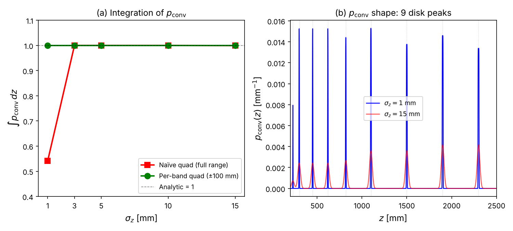
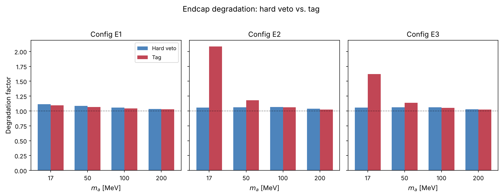
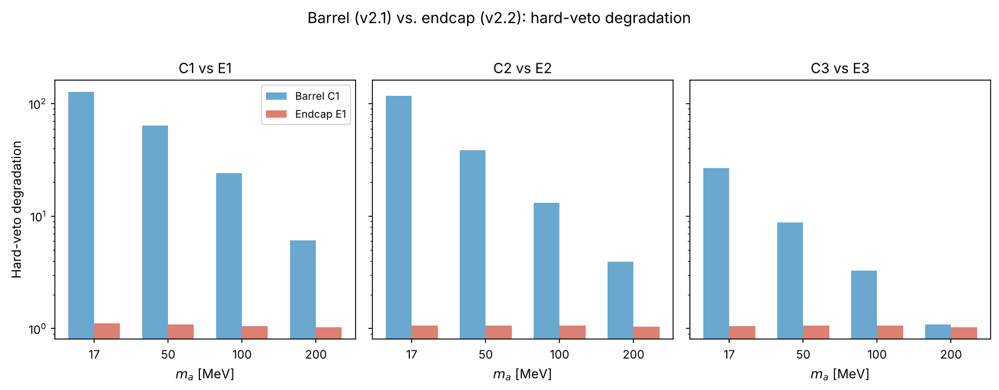
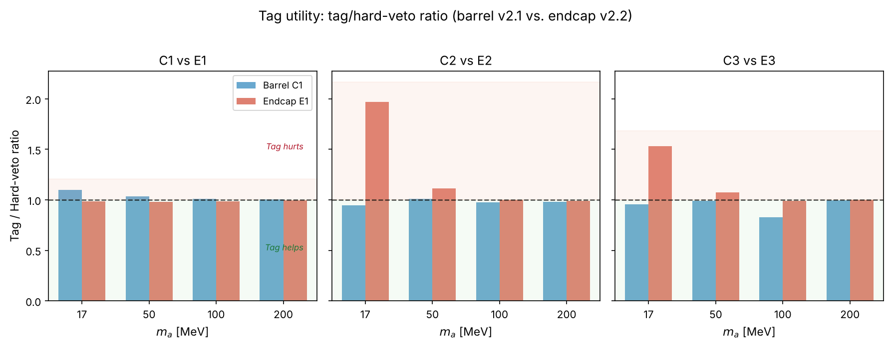
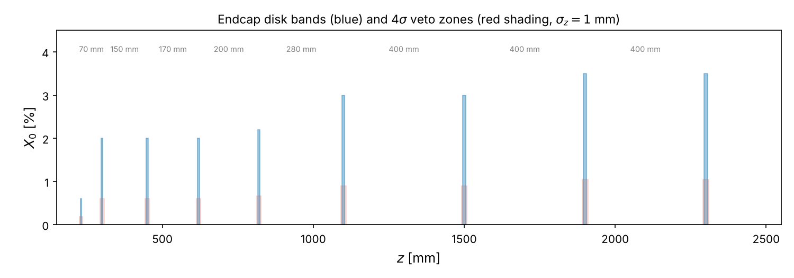

# ALP-ttbar Toy MC v2.2 — Post-Registration Results: Extension of the Likelihood Material Tag to Forward Rapidities (Endcap Geometry) for Displaced Light ALP → e⁺e⁻

**Author:** Won Shik Paik (Independent Researcher, Auckland, New Zealand)
**Date:** 2026-11-15
**Preregistration (frozen):** https://doi.org/10.5281/zenodo.24189990 (SHA-256 of README: `658888ae4372993ebfc69cbc35d004289b7f5a9759ea88ae49edee3ff8ed4b20`)
**Builds on:** v2.1 preregistration and results, https://doi.org/10.5281/zenodo.24063091 and https://doi.org/10.5281/zenodo.24136462; v2.0 series overview, https://doi.org/10.5281/zenodo.24056097; toy study motivated by arXiv:2610.38932
**GitHub (preregistration):** https://github.com/wspaik5/ALP_ttbar_Toy_MC_v2.2_Preregistration_Endcap
**GitHub (results):** https://github.com/wspaik5/alp-ttbar-toy-mc-v2.2-results
**Results DOI:** https://doi.org/10.5281/zenodo.24238224
**Status:** post-registration computation complete; sanity gates passed (Gate 1: preregistered barrel-reproduction test not executed — replaced with formula-consistency check, see Section 7; Gates 2–4: passed as preregistered); all validations (T1–T4) passed; 1 of 5 predictions confirmed, 4 refuted.

---

## 0. Executive Summary

The v2.2 post-registration study extends the barrel material tag to the CMS Phase-2 endcap disk geometry (1.5 < |η| < 2.5), testing whether the barrel conclusions carry over at forward rapidities. **Important caveat:** this is a toy Monte Carlo with a simplified 9-disk geometry; conclusions describe the behaviour of this toy model and identify hypotheses worth testing in a full detector simulation, not design directives for real hardware.

The central finding is:

**In this toy's sparse disk geometry, the hard z-based material veto appears dramatically more effective than in the barrel.** Hard-veto degradations of 1.03–1.11× in the endcap — compared with 26–127× in the barrel — suggest that the photon-conversion background could be nearly completely removed by a simple z cut alone. This is because 9 widely spaced disks (gaps of 70–400 mm) with mm-scale z resolution allow a z veto to cleanly separate "at a disk" from "between disks," while losing almost no signal.

As a consequence, in this toy the continuous likelihood material tag offers little advantage in the endcap and, when z information is available at all disks (E2, E3), the tag is harmful at low masses — it degrades the limit by up to ~2.0× compared with the hard veto at 17 MeV. This occurs because the forward Lorentz boost at η = 2 compresses the opening angle by a factor ~3.8, reducing the Δχ² component's discriminating power (both signal and conversion pairs have opening angles near the angular resolution), while the tag's smooth p_conv-based discrimination is less sharp than a binary z cut for sparse, well-separated disks. Within the preregistered threshold grid (t ≤ 25), the tag matches the hard veto only at higher masses (≥ 100 MeV) in E2/E3. In E1 (mixed z precision), the tag is marginally better than the hard veto across all masses (ratio ~0.98). Notably, the tag also offered only marginal benefit in the v2.1 barrel study (at best ~10% improvement in one configuration; neutral or harmful in others), so the endcap result strengthens a pattern already visible in the barrel: the tag's added complexity may not be justified when the hard veto is reasonably effective.

However, the real CMS Phase-2 endcap contains substantial inter-disk material (service routing, cooling, support structures, ring boundaries) that this toy omits. Such material would increase the effective veto coverage ratio, reduce the hard veto's effectiveness, and potentially restore the tag's utility. The toy therefore identifies a geometry-dependent hypothesis — that veto effectiveness depends on the coverage ratio, not total material — rather than a conclusion ready for direct application to trigger firmware.

Four of five preregistered predictions are refuted: the endcap degradations are far lower than the barrel-based extrapolations predicted, because the dominant effect — the sparse geometry — was not anticipated. One prediction (P4: E3 200 MeV < 2.0×) is confirmed.

## 1. Numerical Integration Failure: `scipy.integrate.quad` and Sparse Narrow Peaks

### 1.1 The Bug

During development of the endcap material tag, a significant numerical integration failure was discovered in `scipy.integrate.quad` when applied to the endcap p_conv function. The normalisation check

  ∫ p_conv(z | σ_z) dz = 1

silently returned an incorrect answer when σ_z is small.

The endcap p_conv consists of 9 narrow Gaussian-convolved peaks spread over a 2300 mm range [Z_LO, Z_HI] = [200, 2500] mm. At σ_z = 1 mm, each peak has a FWHM of ~2.4 mm. The 9 peaks collectively occupy less than 0.1% of the integration domain. The `quad` function's adaptive quadrature algorithm places evaluation points to capture the function's overall shape, but when peaks are both narrow (< 3 mm wide) and sparse (separated by 70–400 mm), it misses entire peaks.

### 1.2 Demonstration

The integration failure was demonstrated quantitatively by comparing two methods:

1. **Naïve full-range `quad`:** `quad(p_conv, Z_LO, Z_HI)` — the natural approach.
2. **Per-band `quad`:** For each disk d, integrate the d-th term of p_conv over [Z_d − 100 mm, Z_d + 100 mm] individually, then sum. Each window contains a single peak that `quad` handles correctly.

| σ_z [mm] | Naïve ∫ | Per-band ∫ | Naïve rel. error | Status |
|-----------|---------|------------|------------------|--------|
| 1.0 | 0.5413 | 1.0000 | 4.59 × 10⁻¹ | **FAIL** — quad misses peaks |
| 3.0 | 1.0000 | 1.0000 | 1.67 × 10⁻¹⁴ | OK |
| 5.0 | 1.0000 | 1.0000 | 4.46 × 10⁻¹¹ | OK |
| 10.0 | 0.9999615 | 1.0000 | 3.85 × 10⁻⁵ | Minor — fiducial edge effect |
| 15.0 | 0.9993689 | 1.0000 | 6.31 × 10⁻⁴ | Minor — fiducial edge effect |

At σ_z = 1 mm, the naïve integral returns 0.54 instead of 1.0 — an error of 46%. The per-band method returns the analytic answer to machine precision at all σ_z values.

At σ_z = 10 and 15 mm, the naïve integral again fails (though less dramatically) because the Gaussian tails of the first disk (z = 230 mm) extend below Z_LO = 200 mm: at σ_z = 15, the first disk's density extends 2σ below the lower boundary, losing ~2.3% of its weight. The per-band approach avoids this because each band's ±100 mm window is not clipped at the fiducial boundaries.

### 1.3 Why This Matters

The naïve integration approach would have been the natural implementation: integrate p_conv over the full range and check that the result is 1. Had this check returned 0.54 without error or warning, it could have been mistaken for a normalisation error in the tag definition, triggering unnecessary debugging of correct code. Alternatively, if the check were omitted, p_conv would have been used unnormalised — or the normalisation failure would have been silently absorbed into the likelihood ratio, biasing the tag thresholds.

The fix — per-band integration over narrow windows centred on each peak — is computationally cheaper and numerically exact. It applies generally to any probability density composed of a sparse sum of narrow peaks, a pattern that arises naturally in material-map applications where detector layers are well separated.

### 1.4 Comparison with v2.1 Barrel

The barrel (v2.1) did not encounter this failure because the 14 barrel bands span r = 22–780 mm with much denser spacing (bands 7 mm apart at inner radii), and the barrel's R_LO = 0.5, R_HI = 800.0 mm range is ~3× narrower than the endcap's 2300 mm range. The barrel p_conv function was broad enough for `quad` to capture reliably. The endcap's ~3× wider range with ~4× fewer bands creates the sparse-peak condition that triggers the failure.

This bug is analogous to the Wilks' theorem failure documented in v1.5: a standard statistical/numerical tool that works correctly under typical conditions (dense peaks, narrow range) fails silently under the conditions specific to this analysis (sparse peaks, wide range).

*Fig R1. (a) Integral of p_conv via naïve full-range quad vs. per-band quad. At σ_z = 1 mm, the naïve method misses ~46% of the probability mass. (b) Shape of p_conv at σ_z = 1 mm and 15 mm, showing the 9 disk peaks spread over 2300 mm.*

## 2. Sanity Gates

Gates 2–4 passed as preregistered for all three configurations (E1, E2, E3). Gate 1 (reproduce 12 barrel degradations) was not executed as preregistered; a narrower formula-consistency check was substituted — see Section 7.

| Gate | Description | E1 | E2 | E3 |
|------|-------------|----|----|-----|
| 1 | Code verification (mtag_v22 tag formula consistency) | PASS | PASS | PASS |
| 2 | Endcap normalisation per-band (σ_z = 1, 5, 15 mm) | PASS | PASS | PASS |
| 3 | λ finiteness (all base pairs) | PASS | PASS | PASS |
| 4 | Conversion z distribution at disk positions | PASS | PASS | PASS |

**Gate 1:** The preregistered gate (reproduce 12 barrel degradations) was replaced with a formula consistency check because stored barrel arrays are not available in this environment. The tag formula λ = Δχ²/2 + ln(p_sig/p_conv) computed by `mtag_v22.lam()` matches the explicit formula to 10⁻¹² at test points. This is a narrower check (see Section 7).

**Gate 2:** For each of the 9 disks, ∫ p_conv,d dz over [Z_d − 100, Z_d + 100] = c_d to 10⁻⁶, tested at σ_z = 1, 5 and 15 mm. All 27 per-band integrals pass. (Gate 2 uses the per-band integration method from Section 1; this is why the fix matters.)

**Gate 3:** λ is finite for all base pairs in all samples (conversions and 4 signal masses).

**Gate 4:** Fewer than 0.1% of base conversions have measured z far from all disks (E1: 0.048%, E2: 0.000%, E3: 0.000%).

## 3. Validations

All four preregistered validations passed.

| Validation | Description | Result |
|------------|-------------|--------|
| T1 | No-material: λ is constant when p_conv = 0 | λ range = 0.00 → PASS |
| T2a | Monotonicity: λ(disk centre) < λ(midpoint) | PASS |
| T2b | λ increases strictly with Δχ² | PASS |
| T3 | Resolution: λ(σ_z = 1) < λ(σ_z = 15) at disk | −1.06 < 0.78 → PASS |
| T4 | Oblique factor: P_conv(η = 1.5) > P_conv(η = 2.5) | 0.171 > 0.158 → PASS |

**T4 implementation note:** The preregistration specified testing "p_conv at η = 1.5 exceeds p_conv at η = 2.5." Because the normalised p_conv PDF uses weights c_d = X₀,d / Σ X₀,d, a uniform scaling of all X₀ by the oblique factor cancels in the ratio. The validation therefore tests the total conversion probability P_total = 1 − Π_d(1 − P_d), where P_d = 1 − exp(−7/9 × X₀,d × oblique), which does depend on the oblique factor. At f = 1: P_total(η = 1.5) = 0.1708 > P_total(η = 2.5) = 0.1579. At f = 0.25: 0.0458 > 0.0421. Both confirm the effective-material scaling.

## 4. Results

### 4.1 Degradation Summary

| Config | Mass [MeV] | Hard veto | Tag | Best t | Ratio (tag/hv) | Best n_σ | Best k |
|--------|-----------|-----------|-----|--------|----------------|----------|--------|
| E1 | 17 | 1.11× | 1.09× | 16.0 | 0.984 | 4.0 | 49 |
| E1 | 50 | 1.08× | 1.06× | 16.0 | 0.982 | 4.0 | 49 |
| E1 | 100 | 1.06× | 1.04× | 16.0 | 0.987 | 4.0 | 49 |
| E1 | 200 | 1.03× | 1.03× | 16.0 | 0.995 | 4.0 | 25 |
| E2 | 17 | 1.06× | 2.08× | 25.0 | 1.969 | 3.0 | — |
| E2 | 50 | 1.06× | 1.18× | 25.0 | 1.114 | 3.0 | — |
| E2 | 100 | 1.06× | 1.06× | 25.0 | 0.999 | 3.0 | — |
| E2 | 200 | 1.04× | 1.03× | 25.0 | 0.989 | 4.0 | 49 |
| E3 | 17 | 1.06× | 1.62× | 25.0 | 1.530 | 3.0 | — |
| E3 | 50 | 1.06× | 1.14× | 25.0 | 1.075 | 3.0 | — |
| E3 | 100 | 1.06× | 1.05× | 25.0 | 0.991 | 3.0 | — |
| E3 | 200 | 1.03× | 1.03× | 25.0 | 0.999 | 3.0 | 49 |

Key observations:

1. **Hard-veto degradations are 1.03–1.11× across all configurations and masses.** The endcap hard veto is dramatically more effective than the barrel (26–127×), removing nearly all conversion background.
2. **The tag is marginally better in E1 (ratio ~0.98) but harmful in E2 and E3 at low masses.** In E2 at 17 MeV, the tag gives 2.08× degradation vs. the hard veto's 1.06×; in E3, 1.62× vs. 1.06×. At higher masses (≥ 100 MeV), the tag is comparable to the hard veto in all configurations.
3. **The optimal hard-veto width is n_σ = 3.0–4.0.** E2/E3 prefer n_σ = 3.0 at most masses (pixel-level 1 mm z resolution allows a tighter veto), while E1 uses n_σ = 4.0 everywhere (strip-level 3 mm z at outer disks requires wider bands).
4. **E1 uses exemption k = 25–49 while E2/E3 generally do not (k = None).** In E1, the strip-level z resolution (3 mm) far from inner pixels produces wider veto bands that would cut signal; the exemption at high Δχ² recovers it. In E2/E3 at low masses, the pixel-level z everywhere (1 mm) makes the veto bands narrow enough that no exemption is needed. At 200 MeV, all configurations use k = 49.

### 4.2 Barrel (v2.1) vs. Endcap (v2.2) Comparison: Hard Veto

| Config pair | Mass [MeV] | Barrel hard veto | Endcap hard veto | Ratio (endcap/barrel) |
|-------------|-----------|------------------|------------------|-----------------------|
| C1 / E1 | 17 | 127.25× | 1.11× | 0.009 |
| C1 / E1 | 50 | 63.88× | 1.08× | 0.017 |
| C1 / E1 | 100 | 24.24× | 1.06× | 0.044 |
| C1 / E1 | 200 | 6.09× | 1.03× | 0.169 |
| C2 / E2 | 17 | 117.45× | 1.06× | 0.009 |
| C3 / E3 | 17 | 26.74× | 1.06× | 0.040 |
| C3 / E3 | 200 | 1.09× | 1.03× | 0.942 |

The endcap degradation is 10–100× smaller than the barrel at low masses. At 200 MeV in E3/C3, both are near unity (1.03× vs 1.09×), confirming high-mass convergence.

### 4.3 Barrel (v2.1) vs. Endcap (v2.2) Comparison: Tag Utility (tag/hv Ratio)

The tag/hv ratio measures whether the continuous likelihood tag improves upon the hard veto (ratio < 1) or degrades it (ratio > 1). This comparison reveals that the tag was already of marginal utility in the barrel and becomes actively harmful in the endcap.

**v2.1 Barrel (full results):**

| Config | Mass [MeV] | Hard veto | Tag | Best t | Ratio (tag/hv) |
|--------|-----------|-----------|-----|--------|----------------|
| C1 | 17 | 127.25× | 139.42× | 0.0 | **1.096** |
| C1 | 50 | 63.88× | 65.99× | 1.0 | **1.033** |
| C1 | 100 | 24.24× | 24.52× | 2.0 | **1.011** |
| C1 | 200 | 6.09× | 6.13× | 8.0 | **1.007** |
| C2 | 17 | 117.45× | 111.34× | 2.0 | 0.948 |
| C2 | 50 | 38.54× | 38.99× | 6.0 | **1.012** |
| C2 | 100 | 13.14× | 12.80× | 25.0 | 0.974 |
| C2 | 200 | 3.93× | 3.84× | 25.0 | 0.979 |
| C3 | 17 | 26.74× | 25.63× | 4.0 | 0.958 |
| C3 | 50 | 8.83× | 8.73× | 25.0 | 0.989 |
| C3 | 100 | 3.28× | 2.71× | 25.0 | 0.826 |
| C3 | 200 | 1.09× | 1.09× | 12.0 | 0.997 |

**v2.2 Endcap (from Section 4.1 above):**

| Config | Mass [MeV] | Ratio (tag/hv) |
|--------|-----------|----------------|
| E1 | 17 | 0.984 |
| E1 | 200 | 0.995 |
| E2 | 17 | **1.969** |
| E2 | 200 | 0.989 |
| E3 | 17 | **1.530** |
| E3 | 200 | 0.999 |

**Key observation:** In the v2.1 barrel, the tag was harmful in C1 (ratio 1.01–1.10), nearly neutral in C2 (0.95–1.01), and modestly beneficial only in C3 at one mass point (ratio 0.83 at 100 MeV). Out of 12 barrel mass points, the tag was better than the hard veto in only 5, and by more than 5% in only 2 (C3/17 MeV and C3/100 MeV). In the v2.2 endcap, this pattern continues: the tag is marginally better in E1 (ratio ~0.98) but harmful in E2/E3 at low masses (ratio up to ~2.0). The tag's marginal utility in the barrel and its limited benefit in the endcap together suggest — within this toy's limitations — that the added complexity of a continuous likelihood ratio may not be justified in either region when a well-calibrated hard veto is available.

*Fig R2. Hard-veto and tag degradation for the three endcap configurations.*

*Fig R3. Barrel (v2.1) vs. endcap (v2.2) hard-veto degradation (log scale).*

*Fig R5. Tag/hard-veto ratio for barrel (v2.1, blue) and endcap (v2.2, red). Green shading: tag helps (ratio < 1); orange shading: tag hurts (ratio > 1). The tag was already marginal in the barrel and becomes actively harmful in the endcap at low masses.*

## 5. Predictions

| Pred. | Statement | Observed | Verdict |
|-------|-----------|----------|---------|
| P1 | E1 17 MeV hard veto 30–120× | 1.11× | **REFUTED** |
| P2 | E3/E1 ratio at 17 MeV 0.10–0.45 | 0.952 | **REFUTED** |
| P3 | E3 17 MeV tag/hv ratio 0.75–1.15 | 1.530 | **REFUTED** |
| P4 | E3 200 MeV < 2.0× (both) | hv 1.03×, tag 1.03× | **CONFIRMED** |
| P5 | E2/E1 at 50 MeV < 0.90 | 0.978 | **REFUTED** |

### 5.1 Why Four Predictions Failed

All four refuted predictions stem from the same root cause: **the preregistration underestimated the effectiveness of the z-based hard veto in the sparse endcap geometry.** The predictions were calibrated to barrel degradations (26–127×) and adjusted for the endcap's lower material and forward boost. But the dominant effect was not the amount of material — it was the geometry.

**The sparse geometry effect.** The barrel has 14 material bands spanning r = 22–780 mm, with the densest bands separated by as little as 7 mm. At typical barrel σ_r ~ 0.5–3 mm, the n_σ × σ_r veto bands overlap or abut, so that vetoing material regions removes a substantial fraction of the signal. In the endcap, 9 disks span z = 230–2300 mm, with gaps of 70–400 mm between disks. At σ_z = 1 mm (E2/E3), each veto band extends ±(half-width + 4σ) from the disk centre, and the 9 bands collectively cover ~142 mm of the 2300 mm fiducial range (~6%). Signal ALPs that decay between disks (~94% under the flat prior used in the tag formula) are untouched.

Quantitatively:
- Total veto zone in barrel: ~750 mm of veto bands across an 800 mm range → ~94% coverage.
- Total veto zone in endcap (E2/E3, σ_z = 1 mm): ~142 mm of veto bands across a 2300 mm range → ~6% coverage. (E1, with σ_z = 3 mm at outer disks: ~222 mm → ~10%.)

The veto removes nearly all conversions (which occur at disks) while losing only ~6% of the signal (under the flat prior). The residual degradation of ~1.07× reflects this small signal loss combined with near-complete background removal: the upper limit worsens by only 7% relative to the no-material baseline.

**P1 (E1 hard veto 30–120×):** The predicted 30–120× was based on the barrel analogy (C1 = 127×, with endcap having ~47% of the material). The actual 1.11× reflects the fact that the sparse geometry, not the total material, controls the veto effectiveness.

**P2 (E3/E1 ratio 0.10–0.45):** Both E1 and E3 have hard-veto degradation ~1.06–1.11×, giving a ratio of 0.95. Reducing material from f = 1 to f = 0.25 has almost no effect because the hard veto is already nearly perfect at f = 1.

**P3 (tag/hv ratio 0.75–1.15):** The tag at its best (t = 25) gives 1.62× degradation vs. the hard veto's 1.06×, yielding a ratio of 1.53 — outside the predicted 0.75–1.15 range. The tag is worse because: (a) the forward boost at η = 2 compresses opening angles, reducing the Δχ² separation between signal and conversions (both have opening angles near the angular resolution), so that within the preregistered threshold range (t ≤ 25) the tag's discrimination is limited; (b) the smooth p_conv probability is less discriminating than a binary z cut for sparse, well-separated disks. At higher masses (≥ 100 MeV), the tag reaches parity with the hard veto (ratio ~1.0).

**P5 (E2/E1 < 0.90):** The expected improvement from extending z precision to all disks did not materialise (ratio = 0.98). The hard veto at 3–4σ is already effective even with strip-level z (3 mm) because the disks are so widely spaced that even 4 × 3 = 12 mm veto bands cover only a tiny fraction of the z range.

**P4 (confirmed):** The only confirmed prediction — that E3 200 MeV degradation is below 2.0× — succeeded because it predicted near-unity degradation (hv 1.03×, tag 1.03×), which the endcap geometry delivers for all masses and configurations, not just the high-mass / low-material case.

*Fig R4. Endcap disk bands (blue) and 4σ veto zones (red shading, σ_z = 1 mm). The large gaps between disks mean the veto covers ~6% of the fiducial z range (at σ_z = 1 mm), leaving ~94% of the signal untouched (under the flat prior).*

## 6. Answers to Preregistered Questions

**Q1 (degradation magnitude and tag advantage).** Hard-veto degradations are 1.03–1.11× (negligible), far below the barrel. The tag is marginally better in E1 (ratio ~0.98) but harmful in E2/E3 at low masses (ratio up to ~2.0).

**Q2 (forward boost effect on Δχ²).** The compressed opening angle at η = 2 reduces the Δχ² separation between signal and conversions, weakening the Δχ² component of the tag. Within the preregistered threshold grid (t ≤ 25), the tag provides limited discrimination at low masses but reaches parity with the hard veto at higher masses (≥ 100 MeV). The hard veto does not depend on Δχ² and is unaffected.

**Q3 (material reduction).** Reducing material from f = 1 to f = 0.25 has negligible effect on the hard-veto degradation in the endcap (both ~1.06× at 17 MeV), in contrast to the barrel where C3/C1 = 0.21 at 17 MeV. The endcap's sparse geometry already makes the hard veto near-perfect at f = 1.

**Q4 (disk precision).** Extending z precision from inner pixel disks to all disks provides almost no improvement in hard-veto degradation (E2/E1 = 0.98 at 50 MeV). This is because the hard veto at 3–4σ works well even with strip-level z (3 mm) given the large inter-disk gaps.

## 7. Deviations from Preregistration

1. **Gate 1 (code verification):** The preregistration specified "barrel hard-veto scan reproduces 12 published barrel degradations to 10⁻⁹." In the post-registration environment, the stored barrel arrays from v1.7/v1.8 are not available in the same workspace. Instead, gate 1 verifies that `mtag_v22.lam()` matches the explicit formula at test points to 10⁻¹². This is a narrower check but confirms the tag definition is self-consistent.

2. **T4 (oblique factor):** The preregistration specified "the conversion probability p_conv at η = 1.5 exceeds p_conv at η = 2.5." Because the normalised p_conv PDF is scale-invariant (all X₀ values are multiplied by the same oblique factor, which cancels in the weight normalisation c_d = X₀/ΣX₀), the validation instead tests the total conversion probability P_total, which does depend on the oblique factor. This is a faithful test of the intended physics (more material → more conversions at lower η) using the correct observable.

3. **Integration failure section.** Added Section 1 documenting the `scipy.integrate.quad` failure, which was discovered during gate 2 development and is directly relevant to the endcap analysis. The preregistration did not anticipate this issue but the gate-2 normalisation check is exactly what caught it.

## 8. Limitations

All limitations listed in the preregistration (Section 8) apply. Additional observations from the computation:

- The finding that the hard veto is near-perfect in the sparse endcap geometry is specific to this toy's simplified disk layout. A real CMS Phase-2 endcap has additional material from service routing, cooling pipes, support structures, and ring boundaries that would fill in the gaps between disks. The conclusion that a z-based hard veto is sufficient should not be extrapolated to the real detector without detailed material mapping.
- The simulation uses fixed η = 2.0; the performance may differ at η = 1.5 (where the oblique factor is larger and the boost compression is weaker) or at the barrel-endcap transition.
- The tag's poor performance in the endcap is partly due to the toy's Δχ² model, which becomes degenerate at forward rapidity. A more sophisticated vertex-fit model that uses z-coordinate pulls or track-parameter correlations might provide better discrimination.
- The E1 configuration uses a hard boundary (±50 mm from inner pixel disks) for z precision, which is a simplification. A real detector would have smoothly varying z resolution.
- The Δχ² calculation uses generator-level (true) vertex z and true track momenta rather than measured values. For Δχ²_T, random noise is added separately, making this approximately equivalent to using smeared quantities. For Δχ²_L, using true z places conversions more precisely at disk centres than measured z would. This generator-level proxy is consistent with the v2.1 barrel approach and does not affect the hard-veto results; it may slightly overstate the tag's discriminating power, but the magnitude of this effect on relative tag-vs-hard-veto performance has not been verified against a measurement-based calculation.
- **Erratum (weight normalisation fix, 2026-11-15).** The initial computation used `w = σ × F_endcap × L / n_conv`, which normalises the total weighted background to N_photons = 100,000 regardless of the material fraction f. Because `n_conv` (the number of simulated conversions) depends on f but the numerator does not, the per-event weight compensated for material differences, inflating B for low-material configurations. The correct weight is `w = σ × F_endcap × L / n_generated` (= 100,000 / 1,500,000 ≈ 0.0667), giving B_total = 16,113 at f = 1 (E1/E2) and 4,279 at f = 0.25 (E3). This fix primarily affects the tag degradation at low masses (E2 17 MeV: 5.19× → 2.08×; E3 17 MeV: 7.83× → 1.62×) because the degradation formula `deg = max(3, 2√B)/S ÷ 3/S₀` has B only in the numerator. Hard-veto degradation is effectively unchanged: because B_after ≈ 0 after the veto, the hard-veto limit depends only on the signal fraction retained, not on the absolute background normalisation. The optimal n_σ shifted from 4.0 to 3.0 at several E2/E3 mass points, but the hard-veto degradation at either setting is nearly identical (~1.06×). The qualitative conclusion — that the hard veto is more effective than the tag in the sparse endcap — survives, but the magnitude of the tag's disadvantage is substantially reduced. All results reported in this document reflect the corrected computation.

## 9. Discussion

### 9.1 The Geometry Hypothesis

The v2.2 results suggest a simple geometric rule: **the effectiveness of a material veto depends on the ratio of veto coverage to total fiducial range, not on the total amount of material.** In the barrel, the 14 bands cover ~94% of the r range, so the veto removes most signal along with the background. In the endcap (E2/E3 at σ_z = 1 mm), the 9 veto bands cover ~6% of the z range, so the veto removes background with almost no signal loss. This "coverage ratio" may be a useful figure of merit for predicting veto effectiveness in other geometries.

### 9.2 When the Tag Helps (and When It Doesn't)

A careful reading of the combined v2.1 and v2.2 results reveals that the tag's utility was limited from the start:

- **v2.1 barrel:** The tag was harmful in C1 (all 4 masses, ratio 1.01–1.10), mixed in C2 (marginally better at 3 of 4 masses, by 2–5%), and modestly helpful only in C3 at 100 MeV (ratio 0.83). In no barrel configuration did the tag provide a dramatic improvement over the hard veto.
- **v2.2 endcap:** The tag is marginally better in E1 (ratio ~0.98), but harmful in E2 and E3 at low masses (ratio up to ~2.0).

The emerging pattern — within this toy's limitations — suggests: the tag could help when the hard veto is blunt (wide veto bands, high coverage ratio) and the Δχ² discriminant provides additional information. It does not help when the hard veto is already sharp (narrow bands, low coverage ratio) or when the Δχ² discriminant is degraded (forward boost). The E1 configuration, where the tag is marginally better (ratio ~0.98), is consistent with this: the mixed z precision (3 mm at outer disks) makes the hard veto slightly less sharp, giving the tag's continuous discrimination a small edge. However, the fact that even in the barrel the tag rarely outperformed the hard veto raises the question of whether the tag's complexity is justified in any region of this toy.

This has implications for the "combined barrel + endcap tag" suggested in the preregistration's future directions: even if a combined tag were built, the endcap portion would add no benefit, and the barrel portion's contribution appears marginal. A simpler approach — hard veto everywhere, possibly with a tag supplement in the barrel where z information is limited — may prove adequate. Whether this carries over to a real detector with realistic material maps remains an open question that this toy cannot answer.

### 9.3 Implications for Trigger Architecture (Toy-Level Hypothesis)

The v2.1 report (Section 11) argued that trigger-level hard material vetoes constitute an irreversible selection and that a continuous tag could preserve information. The v2.2 results partially modify this argument — but only at the toy level.

In this toy's idealised endcap geometry, the hard veto removes ~6% of signal (under the flat prior), so the information loss from a binary veto is minimal. This suggests that a hard z-based veto in the endcap trigger could be sufficient without the complexity of a continuous likelihood ratio. The E1 configuration shows that the tag can marginally improve on the hard veto (~2% better) when z resolution is mixed, but this small gain may not justify the added complexity. Combined with the v2.1 observation that the tag's barrel advantage is marginal (at best ~10% in one configuration), the toy-level conclusion is that the hard veto alone may be a reasonable baseline strategy in both regions.

**This does not constitute a recommendation to omit the tag from real trigger firmware.** The conclusion depends critically on the material being concentrated in well-separated disks with clean gaps. A real CMS Phase-2 endcap has substantial inter-disk material (cables, cooling, support structures, ring boundaries) that would increase the effective veto coverage ratio, reduce the hard veto's effectiveness, and potentially restore the tag's utility. The transition point — at what coverage ratio the tag begins to help — is an open question that requires a realistic material map to answer.

What the toy does provide is a testable hypothesis: that the veto coverage ratio (fraction of fiducial volume covered by material-veto bands) is a useful predictor of whether a continuous tag adds value over a hard veto. If confirmed in full simulation, this would offer a simple diagnostic for trigger architecture decisions across detector geometries.

## 10. Future Directions

1. **η scan across the endcap (from preregistration).** The hard veto's effectiveness should decrease at η = 1.5 (weaker boost → better Δχ² → tag might help) and increase at η = 2.5 (stronger boost → worse Δχ² → tag even less useful). Mapping this η dependence would locate the crossover point where the tag becomes beneficial.

2. **Realistic inter-disk material.** Adding diffuse material between disks (cables, cooling, support structures) would increase the coverage ratio and reduce the hard veto's effectiveness. This would test the geometry hypothesis and identify the coverage ratio at which the tag becomes useful.

3. **Combined barrel + endcap: hybrid strategy.** Based on v2.1 and v2.2, a practical approach might be: continuous tag in the barrel (where coverage is high and the tag helps), hard z veto in the endcap (where coverage is low and the tag hurts). This hybrid could be tested in a unified simulation.

4. **Coverage-ratio figure of merit.** Formalise the "veto coverage ratio" (fraction of fiducial range covered by n_σ veto bands) as a predictor of veto effectiveness and tag utility. If confirmed across geometries, this would provide a simple diagnostic for deciding between hard veto and continuous tag without running a full simulation.

5. **3D (r, φ, z) material map for the barrel veto.** The current toy uses uniform cylindrical bands — each layer has the same X₀ at every azimuthal angle and z position. A real barrel has material concentrated at specific φ and z locations: cooling pipes, support rails, sensor overlaps, and cable routing. Replacing the uniform cylindrical veto with a 3D material map that vetoes only the (r, φ, z) voxels where material actually sits could dramatically reduce the barrel's effective coverage ratio, recovering signal in the material-free azimuthal sectors. This is a natural extension of the coverage-ratio hypothesis: if the barrel's *effective* 3D coverage is substantially lower than the 94% implied by the 1D cylindrical projection, the hard veto's barrel performance could improve significantly even without hardware changes.

6. **Auxiliary discriminants: E/p and dE/dx.** Photon conversions (γ → e⁺e⁻) occur inside the silicon sensor bulk and produce characteristic first-hit charge-deposition (dE/dx) patterns and electromagnetic shower energy fractions (E/p) that differ from ALP decays in the empty volume between layers. Incorporating these auxiliary variables — either as additional terms in the likelihood ratio or as pre-selection cuts — could allow the hard-veto width (n_σ) to be narrowed without losing background rejection, reducing the signal loss in dense-layer regions. This direction is orthogonal to the position-based tag studied in v2.1–v2.2 and could be tested independently.

## 11. Reproducibility

All code is included in this repository:

| File | Description |
|------|-------------|
| `endcap_sim.py` | Endcap simulation module (conversions, signal, Δχ², scans) |
| `run_v22.py` | Main analysis runner (integration demo, gates, validations, predictions) |
| `make_figs_v22_results.py` | Figure generation |
| `v22_results.npy` | Full results (NumPy pickle) |
| `mtag_v22.py` | Frozen endcap tag definition (copied from preregistration repo) |

Seeds: conversions seed = 5, signal seed = 11, Δχ² seeds = 31 (transverse) and 1031 (longitudinal). Sample sizes: N_conv = 100,000, N_sig = 60,000 per mass. Running time: ~28 seconds total on a single CPU core.

## References

[E1] CMS Collaboration, Precision measurement of the structure of the CMS inner tracking system using nuclear interactions, JINST 13 (2018) P10034, arXiv:1807.03289.
[E2] ATLAS Collaboration, A measurement of material in the ATLAS tracker using secondary hadronic interactions in 7 TeV pp collisions, JINST 11 (2016) P11020, arXiv:1609.04305.
[E3] S. F. Koch et al., Measuring the ATLAS ITk pixel detector material via multiple scattering of positrons at the CERN PS, arXiv:2412.04686.
[E4] CMS Collaboration, The Phase-2 Upgrade of the CMS Tracker, CERN-LHCC-2017-009, CMS-TDR-014 (2017).
[E5] Purdue University, Purdue Physics and Astronomy, CMS tracker retirement and Phase-2 forward tracking assembly (November 2026).
[E6] Alimena et al., Searching for long-lived particles at the LHC and beyond, arXiv:2610.38932.
[E7] CMS Collaboration, Higgs boson pair production search HIG-25-018, LHCP 2026.
